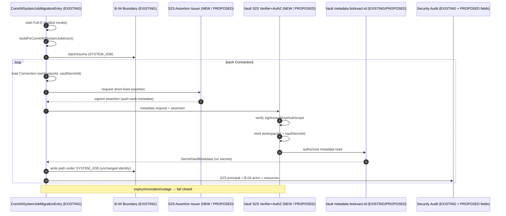

# FIV-CONN-04-D — S2S Authentication Architecture Discovery

```text
S2S ARCHITECTURE DISCOVERY — PENDING PRODUCT OWNER DECISION

KO-COND-01: OPEN — PENDING PRODUCT OWNER DECISION
FULL-D IA: GRANTED WITH AMENDMENTS
KICKOFF: COMPLETED — PASS WITH CONDITIONS
FULL-D IMPLEMENTATION: NOT STARTED
STAGES 4–8: BLOCKED
FIV-CONN-04-E: NOT AUTHORIZED
BACKFILL: NOT STARTED
PRODUCTION ACTIVATION: NOT AUTHORIZED
```

**Document:** Architecture-level investigation and decision-ready design package for a genuine Service-to-Service (S2S) authentication mechanism between trusted caller `Conn04SystemJobMigrationEntry` and Vault metadata access under FIV-CONN-04-D environment backfill.  
**Date:** 2026-10-30  
**Wave:** 6 — Live Trading  
**Package:** V3-L02 / FIV-CRED-02 / FIV-PRE-01 / FIV-CONN-04-D  
**Nature:** **DOCUMENTATION / DISCOVERY ONLY.** Does **not** implement any S2S mechanism. Does **not** close KO-COND-01. Does **not** amend IA, ratification, Kickoff Completion, Trust-Boundary Review, PO Decision Package, or Decision Register. Does **not** modify application source, tests, schema, migrations, Vault ACL, configuration, or deployment. Does **not** stage, commit, or push.

**Evidence labels:** **VERIFIED** | **INFERRED** | **UNKNOWN** | **PROPOSED** (not implemented) | **ABSENT**

---

## 1. Baseline and governing sources

### 1.1 Repository baseline

| Field              | Value                                                                                                   |
| ------------------ | ------------------------------------------------------------------------------------------------------- |
| Branch             | `main`                                                                                                  |
| HEAD               | `953292675e197d4f25778aaaa59eacb2826560fe`                                                              |
| Index              | empty (**VERIFIED**)                                                                                    |
| IA package SHA-256 | `fee16e975ac9d117c336799e4708ba137635ef387cdd5dc28d8aeb0ca519b039` (**VERIFIED** match to ratification) |
| This act creates   | Exactly one new document (this file)                                                                    |

Pre-existing dirty and untracked paths are preserved unchanged.

### 1.2 Governing sources verified

| #   | Artifact                                | Path                                                                                                   | Role / status                                                                   |
| --- | --------------------------------------- | ------------------------------------------------------------------------------------------------------ | ------------------------------------------------------------------------------- |
| 1   | PO Vault Authorization Decision Package | `docs/project/version-3/wave-6/v3-l02-fiv-conn-04-d-po-vault-authorization-decision-package.md`        | Decision prep; options A–D; **not** a ratified selection in-register            |
| 2   | Trust-Boundary Review                   | `docs/project/version-3/wave-6/v3-l02-fiv-conn-04-d-po-vault-trust-boundary-review.md`                 | DI ≠ authentication; recommends further S2S discovery if DI rejected            |
| 3   | Stage 1 Vault/Entry design              | `docs/project/version-3/wave-6/v3-l02-fiv-conn-04-d-stage-1-vault-entry-design.md`                     | KO-COND-01 gap; no S2S Vault path                                               |
| 4   | Full-D IA                               | `docs/project/version-3/wave-6/v3-l02-fiv-conn-04-d-implementation-authorization.md`                   | Sole scope authority; §7.0 binds `list` + exact-id                              |
| 5   | Full-D IA ratification                  | `docs/project/version-3/wave-6/v3-l02-fiv-conn-04-d-full-implementation-authorization-ratification.md` | **D-CONN04-FULL-D-IA** GRANTED WITH AMENDMENTS                                  |
| 6   | Kickoff Completion                      | `docs/project/version-3/wave-6/v3-l02-fiv-conn-04-d-kickoff-completion.md`                             | **D-CONN04-FULL-D-KO**; KO-COND-01 OPEN; KO-COND-02 SATISFIED                   |
| 7   | Wave 6 PO Decision Register             | `docs/project/version-3/wave-6/wave-6-po-decision-register.md`                                         | CURRENT: KO-COND-01 **OPEN**                                                    |
| 8   | Security architecture                   | `docs/Architecture/015-Security.md`                                                                    | Human auth, least privilege, Vault secrets; **no** S2S machine-principal design |
| 9   | Service architecture                    | `docs/Architecture/012-Service-Architecture.md`                                                        | Conceptual API Gateway; **no** mTLS/S2S implementation                          |

**Discrepancies vs task §3 governance state:** **None.** Register and Kickoff Completion still show KO-COND-01 OPEN; Full-D execution NOT STARTED; Stages 4–8 blocked.

### 1.3 Product Owner architectural direction (Variant 2) — interpretation

This discovery task is constrained by the Product Owner architectural direction:

> **Require a separately authenticated service-to-service principal/capability. NestJS DI visibility or possession of a provider token alone is NOT an acceptable trust root.**

**Decision interpretation (**binding for this discovery**):**

| Statement                                                                                                               | Status                                           |
| ----------------------------------------------------------------------------------------------------------------------- | ------------------------------------------------ |
| S2S authentication is a **mandatory** architectural requirement for Vault metadata access from Full-D Entry             | **DOCUMENTED REQUIREMENT** (task / PO direction) |
| Plain `SYSTEM_JOB` strings are **not** authentication                                                                   | **VERIFIED** (trust-boundary + Stage 1)          |
| NestJS DI visibility is **not** authentication                                                                          | **VERIFIED**                                     |
| Private closure / TypeScript `private` alone is **not** authentication                                                  | **VERIFIED**                                     |
| Provider token possession alone is **not** authentication                                                               | **VERIFIED**                                     |
| Human owner impersonation is **not** permitted                                                                          | **VERIFIED** / prior packages                    |
| Caller-supplied `userId` / `Role` / `trusted=true` / workspace claims are **not** trusted credentials                   | **VERIFIED**                                     |
| Canonical B-04 SYSTEM_JOB identity remains unchanged and **separate** from Vault S2S identity                           | **DOCUMENTED REQUIREMENT**                       |
| This direction does **not** select concrete S2S technology, protocol, token format, credential store, or implementation | **DOCUMENTED REQUIREMENT**                       |

**Governance note:** Wave 6 Decision Register still records **KO-COND-01 OPEN** without a formal decision-ID closure for Variant 2. This discovery treats Variant 2 as the architectural constraint for design options. **It does not close KO-COND-01.** A concrete S2S design must be reviewed and separately ratified. Any change beyond current IA §7 inventory requires an IA amendment and renewed independent review.

### 1.4 Current governance state — preserve exactly

```text
Full-D IA: GRANTED WITH AMENDMENTS
Kickoff: COMPLETED — PASS WITH CONDITIONS
KO-COND-01: OPEN — PENDING PRODUCT OWNER DECISION
Full-D implementation: NOT STARTED
Stages 4–8: BLOCKED
FIV-CONN-04-E: NOT AUTHORIZED
Backfill: NOT STARTED
Production activation: NOT AUTHORIZED
```

---

## 2. Existing S2S infrastructure findings

### 2.1 Search coverage

Inspected (non-exhaustive symbol list): auth JWT stack; Vault ACL; Connections Entry/identity/migration-gate; exchange HMAC; wrapping key; Nest module exports; `apps/api/package.json`; `infrastructure/docker`; Architecture security/service docs; Wave-6 CONN-04-D packages.

### 2.2 Finding inventory

| ID  | Path                                                                            | Symbol / key                                                         | Actual behavior                                                        | Machine/service auth?                  | Prod / test | Reuse for Vault S2S?                                         | Limitations                                        |
| --- | ------------------------------------------------------------------------------- | -------------------------------------------------------------------- | ---------------------------------------------------------------------- | -------------------------------------- | ----------- | ------------------------------------------------------------ | -------------------------------------------------- |
| F1  | `apps/api/src/modules/auth/jwt.strategy.ts`                                     | `JwtStrategy`, `JwtPayload` (`sub`,`email`,`role`,`sid`)             | Validates HS JWT then resolves human session + Identity user           | **No**                                 | Prod        | **No**                                                       | Human session model; no `iss`/`aud`                |
| F2  | `apps/api/src/modules/auth/jwt-auth.guard.ts`                                   | `JwtAuthGuard`, `APP_GUARD`                                          | Global HTTP guard; `@Public()` escape only                             | **No**                                 | Prod        | **No**                                                       | HTTP-only; no machine strategy                     |
| F3  | `apps/api/src/modules/auth/jwt-secret.ts`, `auth.module.ts`                     | `JWT_SECRET`, `DEV_JWT_FALLBACK_SECRET`                              | Symmetric signing secret for human access tokens                       | **No**                                 | Prod        | **Unsafe** to overload                                       | Same secret class as user sessions; no JWKS        |
| F4  | `apps/api/src/modules/auth/authentication.service.ts`                           | `issueSession`, `revokeSession`, refresh TTL                         | Human session issue/refresh/revoke                                     | **No**                                 | Prod        | **No**                                                       | Requires Identity user                             |
| F5  | `apps/api/src/modules/auth/roles.guard.ts`, `authorization-decision.service.ts` | `RolesGuard`, `PermissionClass`                                      | RBAC for `request.user`                                                | **No**                                 | Prod        | **No**                                                       | No non-human role catalog for Vault S2S            |
| F6  | `apps/api/src/modules/auth/auth-session.store.ts`                               | `secretsMatch`, `timingSafeEqual`                                    | Constant-time compare / refresh hashing                                | **No**                                 | Prod        | **Partial** primitive only                                   | Not an S2S protocol                                |
| F7  | `apps/api/src/modules/connections/fiv-conn-04-d-system-job-identity.ts`         | `buildFivConn04DSystemJobActor`, `FIV_CONN_04_D_SYSTEM_JOB_ACTOR_ID` | Constructs frozen B-04 `PrivilegedActorContext` from ratified literals | **Partial** logical actor string       | Prod code   | **Unsafe / No** for Vault                                    | Forgeable public literal; not crypto attestation   |
| F8  | `apps/api/src/modules/connections/fiv-conn-04-d-system-job-migration-entry.ts`  | `Conn04SystemJobMigrationEntry`                                      | Builds SYSTEM_JOB internally; delegates to B-04; **not exported**      | **Partial** construction boundary      | Prod code   | **No** as-is                                                 | Does not authenticate to Vault; Nest wall ≠ crypto |
| F9  | `apps/api/src/modules/connections/migration-gate.ts`                            | `PrivilegedActorContext`, lease grant TTL                            | Shape-validates actor; durable DB lease for CONN-04 write authority    | **Partial** lease under claimed holder | Prod        | **No**                                                       | Comment: not VaultConnections replacement          |
| F10 | `apps/api/src/modules/connections/connection-migration-gate-audit.ts`           | `attribution.actorId`                                                | Non-human audit attribution for migration-gate                         | Attribution only                       | Prod        | **Partial** audit pattern                                    | Attribution ≠ authentication                       |
| F11 | `apps/api/src/modules/secret-vault/vault-access-control.ts`                     | `VaultAccessControl.assertCanAccess`                                 | Membership (`ownerUserId===userId`) + C8 Trader/Admin                  | **No**                                 | Prod        | **No** without redesign                                      | No SYSTEM_JOB / S2S branch                         |
| F12 | `apps/api/src/modules/secret-vault/secret-vault.service.ts`                     | `list` / `get` / `retrieve` / private `authorize`                    | All paths run Vault ACL                                                | **No**                                 | Prod        | Public `list` reusable **only** after separate S2S auth gate | Injectable ≠ authorized                            |
| F13 | `apps/api/src/modules/secret-vault/wrapping-key.ts`, `secret-envelope.ts`       | `VAULT_WRAPPING_KEY`, AES-256-GCM                                    | Host wrapping for ciphertext at rest                                   | **No**                                 | Prod        | **No**                                                       | Confidentiality of stored secrets, not caller auth |
| F14 | Exchange HMAC adapters / `live-venue-request.ts`                                | `createHmac('sha256', …)`                                            | Signs outbound venue REST                                              | **No** (platform→venue)                | Prod        | **No**                                                       | Wrong trust domain                                 |
| F15 | Nest module export walls                                                        | `ConnectionsModule` / `SecretVaultModule`                            | Limits injectability across modules                                    | **No**                                 | Prod        | **Unsafe alone**                                             | Same-module providers can inject; not crypto       |
| F16 | `apps/api/package.json`                                                         | `@nestjs/jwt`, `passport-jwt`, `bcrypt`                              | Human JWT + passwords                                                  | **No** S2S libs                        | Prod        | JWT stack **unsafe** to overload                             | No `jose`/SPIFFE/OAuth client-credentials          |
| F17 | `infrastructure/docker/docker-compose.yml`                                      | Postgres compose                                                     | Local DB only                                                          | **No**                                 | Dev         | **No**                                                       | No k8s/Helm/terraform/mTLS/SPIFFE                  |
| F18 | `docs/releases/rc-1/security.md`                                                | baseline checks                                                      | Helmet/rate-limit/secretHits report                                    | **No**                                 | Docs        | **No**                                                       | Not S2S design                                     |

### 2.3 Explicit absences (**ABSENT** / **VERIFIED**)

| Mechanism                                                   | Status                                      |
| ----------------------------------------------------------- | ------------------------------------------- |
| mTLS / mutual TLS client certificates                       | **ABSENT**                                  |
| Service principal / service-account registry                | **ABSENT**                                  |
| SPIFFE / SPIRE / workload identity                          | **ABSENT**                                  |
| Cloud IAM roles for pods / IRSA / k8s ServiceAccount wiring | **ABSENT** (no k8s/terraform trees)         |
| OAuth2 client-credentials / service assertions              | **ABSENT**                                  |
| Internal signed service JWTs with `iss`/`aud`/scope         | **ABSENT** (human JWT only; no iss/aud)     |
| Internal API-key auth for Nest services                     | **ABSENT**                                  |
| HMAC for **internal** S2S request authentication            | **ABSENT** (venue HMAC only)                |
| Asymmetric sign/verify for internal callers                 | **ABSENT** (Vault envelope is at-rest wrap) |
| Unforgeable capability tokens for Vault                     | **ABSENT**                                  |
| Generic run-as / impersonation API                          | **ABSENT**                                  |
| Vault ACL path that authenticates a machine principal       | **ABSENT**                                  |

**Verdict:** The repository has **human authentication**, **host secret wrapping**, **outbound vendor signing**, and a **non-crypto SYSTEM_JOB string + migration-gate lease**. It does **not** have a production-ready S2S authentication mechanism suitable to authorize Vault under Variant 2.

---

## 3. Required identity and trust model

### 3.1 Three distinct identities

| #   | Identity                              | Canonical form (today / proposed)                                                                                  | Authoritative source                                                    | Purpose                                                |
| --- | ------------------------------------- | ------------------------------------------------------------------------------------------------------------------ | ----------------------------------------------------------------------- | ------------------------------------------------------ |
| 1   | **B-04 business attribution**         | `actorKind = SYSTEM_JOB`, `actorId = system-job:fiv-conn-04-migration-backfill`                                    | `buildFivConn04DSystemJobActor` only (**VERIFIED**)                     | Migration-gate lease + CONN-04 write audit attribution |
| 2   | **Vault S2S authenticated principal** | **PROPOSED** dedicated machine/service subject (e.g. `svc:fiv-conn-04-d-vault-metadata`) — **not** the B-04 string | Cryptographic or platform-backed issuer / trust root (**ABSENT today**) | Authenticate caller to Vault metadata operation        |
| 3   | **Connection / workspace resource**   | `connectionId`, `workspaceId`, `vaultSecretId`                                                                     | Connection row / Prisma + Vault record PK (**VERIFIED** data fields)    | Scope and exact-id binding                             |

### 3.2 Binding rules (**PROPOSED** design requirements)

1. **B-04 identity** authenticates **nothing** for Vault. It continues unchanged for migration-gate.
2. **Vault S2S principal** is authenticated **independently** of B-04 actor strings.
3. Vault authorization must **not** trust a caller-supplied `workspaceId` alone. Authoritative binding:
   - Entry loads Connection by `connectionId` from durable store;
   - derives `workspaceId` and `vaultSecretId` from that Connection;
   - presents those values to Vault **together with** a verified S2S assertion;
   - Vault re-validates that the authenticated principal is permitted for operation `vault.metadata.read` (or equivalent) **and** that the named `vaultSecretId` belongs to the named `workspaceId` (or list+exact-id equality under Path 1).
4. Audience of any credential must be restricted to **Vault metadata access** (not general API, not retrieve).
5. Scope must be **metadata-only**: no secret retrieval, decryption, create, update, or revoke.
6. Fail closed on missing/expired/revoked credentials, workspace mismatch, or exact-id miss.

### 3.3 Trust relationship (intended)

```text
┌──────────────────────────────┐
│ Product / Security authority │  ← owns trust root / issuer / keys (PROPOSED)
└──────────────┬───────────────┘
               │ issues / rotates credentials
               ▼
┌──────────────────────────────┐
│ Conn04SystemJobMigrationEntry│  ← obtains S2S credential via approved mechanism
│ + B-04 SYSTEM_JOB (separate) │
└──────────────┬───────────────┘
               │ presents authenticated S2S principal + resource binding
               ▼
┌──────────────────────────────┐
│ Vault verifier + authorizer  │  ← authenticates principal; authorizes metadata-only op
│ (NEW / PROPOSED gate)        │     binds workspaceId + vaultSecretId
└──────────────────────────────┘
```

Nest DI remains a **composition** concern only. It is **not** the trust root under Variant 2.

---

## 4. Alternative mechanisms

### 4.1 Option S2S-A — Signed short-lived service assertion

**Idea:** A trusted internal issuer signs a short-lived assertion for the FIV-CONN-04-D Vault service identity. Vault validates signature, issuer, audience, expiry, subject, and permitted scope.

| Topic                                     | Assessment                                                                                                                                                                         | Label                                                                 |
| ----------------------------------------- | ---------------------------------------------------------------------------------------------------------------------------------------------------------------------------------- | --------------------------------------------------------------------- |
| Issuer ownership                          | **No** existing service-assertion issuer. Human JWT issuer is Auth module for sessions — **wrong class**                                                                           | **ABSENT** / unsafe reuse                                             |
| Signing key custody                       | Would need **new** dedicated key material (asymmetric preferred); must **not** reuse `JWT_SECRET` or `VAULT_WRAPPING_KEY`                                                          | **PROPOSED** / **INFERRED**                                           |
| Verification key distribution             | Vault verifier needs public key / JWKS; not present                                                                                                                                | **ABSENT**                                                            |
| Claims / scope                            | e.g. `sub`, `iss`, `aud=vault-metadata`, `scope=vault.metadata.list                                                                                                                | exact-id`, optional `workspaceId`/`vaultSecretId`binding,`jti`, `exp` | **PROPOSED** |
| Lifetime / clock skew                     | Short TTL (minutes) + skew policy (e.g. ±30–60s); fail closed on expiry mid-run → re-issue or abort                                                                                | **PROPOSED**                                                          |
| Replay                                    | `jti` + single-use cache **or** bind to request nonce/timestamp; neither exists                                                                                                    | **ABSENT**                                                            |
| Rotation / revocation                     | Key rotation + denylist/`jti` store; none for service assertions                                                                                                                   | **ABSENT**                                                            |
| Existing signing infrastructure suitable? | Human HS256 JWT **without** iss/aud — **not suitable**                                                                                                                             | **VERIFIED**                                                          |
| Secure issuance only to Entry?            | Requires issuer that only mints for approved process identity — circular without platform workload identity **or** tightly controlled local signing key held only by Entry process | **INFERRED**                                                          |

**Viability today:** **Not adoptable without new infrastructure.** Technically the strongest _greenfield application-level_ pattern **if** PO authorizes a new issuer + keys + verifier.

### 4.2 Option S2S-B — HMAC-based service authentication

**Idea:** Shared secret signs a canonical request or challenge; Vault verifies.

| Topic                         | Assessment                                                           | Label                                              |
| ----------------------------- | -------------------------------------------------------------------- | -------------------------------------------------- |
| Secret provisioning / storage | No internal S2S HMAC secret lifecycle                                | **ABSENT**                                         |
| Existing HMAC                 | Venue outbound only (`createHmac`)                                   | **VERIFIED** wrong domain                          |
| Canonical request             | Would be home-grown protocol                                         | Task forbids designing home-grown crypto protocols |
| Timestamp / nonce / replay    | Not present for internal calls                                       | **ABSENT**                                         |
| Blast radius                  | Shared secret = any holder can forge; rotation hard                  | **INFERRED** high                                  |
| Stronger than API key?        | Often **not** meaningfully, if secret is long-lived and process-wide | **INFERRED**                                       |

**Viability today:** **Not recommended.** No established internal HMAC auth library/pattern; would invent a protocol; blast radius poor vs Variant 2 bar.

### 4.3 Option S2S-C — mTLS / workload identity

| Topic                               | Assessment                                                                             | Label        |
| ----------------------------------- | -------------------------------------------------------------------------------------- | ------------ |
| Runtime/platform support            | Docker Compose Postgres only; no mesh/k8s ServiceAccount/SPIFFE evidenced              | **ABSENT**   |
| Cert / workload provisioning        | None                                                                                   | **ABSENT**   |
| App-level scope check still needed? | **Yes** — mTLS proves process identity, not `vault.metadata` scope or exact-id binding | **INFERRED** |
| Local-dev complexity                | High without platform story                                                            | **INFERRED** |

**Viability today:** **Not available.** Do **not** claim mTLS exists.

### 4.4 Option S2S-D — Existing platform identity provider

| Topic                                    | Assessment                  | Label        |
| ---------------------------------------- | --------------------------- | ------------ |
| Existing IdP for machines                | Human JWT/session Auth only | **VERIFIED** |
| Non-human identity issuance              | **None**                    | **ABSENT**   |
| Audience/scope-restricted service tokens | **None**                    | **ABSENT**   |
| Available in all environments            | N/A                         | **ABSENT**   |

**Verdict:** **No such provider exists** for this application today.

### 4.5 Option S2S-E — STOP / new infrastructure decision

Because S2S-A–D cannot be adopted from **existing** evidenced infrastructure without inventing unsafe trust roots (DI, strings, overloaded `JWT_SECRET`), the evidence-backed platform decision is:

```text
STOP — PLATFORM S2S AUTHORITY REQUIRED
```

**Minimum additional infrastructure** (if PO later authorizes greenfield) would include **at least**:

1. Explicit trust-root ownership (Security/Platform vs application-local).
2. Dedicated service identity registry or equivalent subject naming.
3. Credential issuance path usable only by the trusted Full-D Entry process (or equivalent workload).
4. Vault-side verifier + metadata-only authorizer (new inventory).
5. Rotation, revocation, emergency disable, audit of allow/deny.
6. Non-production test doubles that do **not** ship production credentials.
7. IA §7 inventory amendment + renewed independent review before coding.

---

## 5. Authentication and authorization properties

Every viable design must satisfy:

### 5.1 Authentication

| Property                      | Requirement                                             |
| ----------------------------- | ------------------------------------------------------- |
| Proof of service identity     | Cryptographic or platform-backed — **not** DI / strings |
| Issuer / trust-root ownership | Explicit and documented                                 |
| Audience restriction          | Vault metadata access only                              |
| Anti spoof                    | Reject caller-controlled identity fields                |
| Independence from B-04        | No reliance on SYSTEM_JOB actor strings                 |

### 5.2 Authorization

| Property     | Requirement                                                          |
| ------------ | -------------------------------------------------------------------- |
| Principal    | Dedicated non-human Vault S2S principal                              |
| Operation    | Exact permitted op (metadata list and/or exact-id metadata)          |
| Data         | Metadata only — no retrieve/decrypt/mutate                           |
| Binding      | Workspace + exact `vaultSecretId` (authoritative Connection-derived) |
| Failure mode | Fail closed                                                          |

### 5.3 Replay and expiry

Short-lived credentials or request freshness; replay prevention appropriate to mechanism; clock-skew policy; mid-run expiry → re-issue or abort fail-closed.

### 5.4 Revocation and rotation

Documented rotation; revocation/disable; key-compromise response; emergency stop; fail-closed on issuer/verifier outage (prefer deny over allow).

### 5.5 Audit

Log authenticated S2S principal **and** B-04 business actor separately; correlate operation + resource IDs; never log secrets/credentials; allow and deny events; preserve correlation IDs.

### 5.6 Isolation

Workspace ID derived/verified from authoritative Connection data; exact `vaultSecretId` binding; no cross-workspace metadata; no unrelated Vault methods.

---

## 6. Credential lifecycle and deployment model

**Status:** Entire lifecycle is **PROPOSED** / **UNKNOWN pending platform decision** — none of the following exists today.

| Step                         | Required behavior                                                                                                  |
| ---------------------------- | ------------------------------------------------------------------------------------------------------------------ |
| 1. Provision identity        | Register dedicated Vault S2S subject for CONN-04-D metadata; separate from B-04 actorId                            |
| 2. Trust-root / key custody  | Security/Platform (preferred) or explicitly ratified application-managed keys — **not** in source control          |
| 3. Entry obtains credentials | Runtime issuance to Entry process only (platform identity → assertion, or local signer gated by deployment secret) |
| 4. Vault validates           | Signature/platform proof + iss + aud + exp + sub + scope                                                           |
| 5. Scope / resource binding  | Enforce metadata-only + workspaceId + vaultSecretId                                                                |
| 6. Expiry                    | Short TTL; fail closed; optional refresh within run                                                                |
| 7. Rotation                  | Dual-key overlap window; redeploy without downtime plan                                                            |
| 8. Revocation                | Disable subject / denylist jti / kill switch config                                                                |
| 9. Emergency disable         | Feature flag or revoke subject → all Vault S2S calls deny                                                          |
| 10. Local/dev/test           | Test doubles / ephemeral keys; never production credentials in CI logs                                             |
| 11. Deployment environments  | Secrets via deployment secret store (env/secret manager) — **not** ordinary app config committed to git            |
| 12. Compromised instance     | Revoke instance credentials; rotate keys; audit trail review                                                       |

**Distinctions:**

| Class                        | Example                               | Acceptable for S2S trust root?                    |
| ---------------------------- | ------------------------------------- | ------------------------------------------------- |
| Static source config         | Hard-coded actor strings              | **No**                                            |
| Deployment secrets           | Signing private key in secret manager | **Partial** (supports A, but needs issuer design) |
| Platform-issued identity     | SPIFFE / cloud workload identity      | Preferred if available (**ABSENT**)               |
| Runtime-generated assertions | Short-lived signed tokens             | Preferred application pattern (**ABSENT**)        |

**Do not** store a permanent shared secret in source code or ordinary committed application configuration.

---

## 7. Exact-ID metadata design

### 7.1 IA §7.0 baseline (**VERIFIED**)

Fresh Vault **metadata** by exact `vaultSecretId` uses:

1. `SecretVaultService.list(actorWorkspaceId, workspaceId, actorRole?)`
2. Exact match `meta.id === connection.vaultSecretId`

**FACT:** No separate exact-id Vault getter on `SecretVaultRepository` (`findBySlot` is type/purpose slot; `listByWorkspaceId` is workspace list). Prisma PK `findUnique({ id })` is technically possible but **not** exposed on the repository interface today.

`get` is **forbidden** for this purpose (slot-based, not exact-id).

### 7.2 Path 1 — Preserve literal `list()` behavior

| Aspect    | Assessment                                                                                         |
| --------- | -------------------------------------------------------------------------------------------------- |
| S2S role  | Authenticates/authorizes a narrow **metadata-list** operation                                      |
| Freshness | Existing list-plus-exact-ID comparison (**IMPL-REV-D-06**)                                         |
| Filtering | Prefer filter **inside Vault-owned boundary**; only exact metadata result crosses into Connections |
| IA impact | Preserves §7.0 algorithm wording; still needs inventory for S2S verifier / auth gate               |

### 7.3 Path 2 — Introduce exact-ID metadata access

| Aspect    | Assessment                                                                                                                     |
| --------- | ------------------------------------------------------------------------------------------------------------------------------ |
| Shape     | Vault-owned method queries by `workspaceId` **and** `vaultSecretId`; returns metadata or null                                  |
| Secrets   | Must not return ciphertext or decrypted values (`toSecretVaultMetadata` pattern)                                               |
| Freshness | Can preserve D-06 semantic freshness if read is live and fail-closed                                                           |
| IA impact | **IA §7.0 currently names `list()` and exact-ID comparison. Replacement requires formal IA amendment and independent review.** |

### 7.4 Recommendation on Paths 1 vs 2

- **Default under current IA:** **Path 1** (preserve literal `list` + equality), with S2S gate in front and filtering kept Vault-side where possible.
- **Security-preferred data minimization (optional):** **Path 2**, but **only after** explicit IA §7.0 amendment + renewed review.
- Do **not** silently rewrite the approved algorithm.

---

## 8. Sequence diagram (recommended posture)

Recommended posture given evidence: **STOP for implementation**, with the following sequence describing the **conditionally preferred greenfield design (S2S-A)** **if** Product Owner later authorizes **new platform/application S2S infrastructure**. Every new component is labeled **NEW / PROPOSED**.

```text
Actor: Operator / authorized invoker (Nest-internal; not public HTTP under COND-IA-03)
Participant: Conn04SystemJobMigrationEntry [EXISTING]
Participant: B-04 Migration Boundary [EXISTING]
Participant: S2S Assertion Issuer [NEW / PROPOSED]
Participant: Vault S2S Verifier + Metadata Authorizer [NEW / PROPOSED]
Participant: SecretVault metadata path (list or exact-id) [EXISTING list / PROPOSED exact-id]
Participant: Security Audit [EXISTING pattern; PROPOSED event fields]

1. Entry starts explicitly invoked Full-D operation
2. Entry builds B-04 actor via buildFivConn04DSystemJobActor()  // unchanged, separate
3. Entry acquires/renews migration-gate grant via B-04
4. For each Connection candidate:
   a. Entry loads Connection → authoritative workspaceId + vaultSecretId
   b. Entry requests short-lived service assertion from Issuer [NEW / PROPOSED]
      (sub=Vault S2S principal, aud=vault-metadata, scope=metadata-only,
       optional resource bind, exp, jti)
   c. Entry calls Vault metadata API presenting assertion (NOT human userId/Role;
      NOT SYSTEM_JOB strings as credentials)
   d. Vault Verifier authenticates S2S principal [NEW / PROPOSED]
   e. Vault Authorizer checks metadata-only scope + workspace/exact-id bind
      [NEW / PROPOSED]
   f. Fresh metadata returned without secret material
   g. Occupancy + C classifier (existing IA §7.0 dependencies)
   h. B-04 write authority path retains SYSTEM_JOB attribution independently
   i. Audit records: S2S principal + B-04 actorId + correlationId + resource ids
      (no credential material)
5. On credential expiry/revocation/issuer outage: fail closed (deny / abort)
```



This diagram is **not** an existing implementation.

---

## 9. Threat model

| Threat                                 | Attack path                                         | Proposed control                                                           | Residual risk                         | Required evidence / test                                         |
| -------------------------------------- | --------------------------------------------------- | -------------------------------------------------------------------------- | ------------------------------------- | ---------------------------------------------------------------- |
| Forged SYSTEM_JOB actor strings        | Attacker passes B-04 literals to gullible Vault API | Vault must **ignore** SYSTEM_JOB strings as credentials; require S2S proof | Low if verifier enforced              | Negative: SYSTEM_JOB strings alone → deny                        |
| Forged Vault service identity claims   | Caller sets `trusted` / fake `sub`                  | Cryptographic/platform verification only                                   | Medium if keys weak                   | Negative: unsigned/forged assertion → deny                       |
| Stolen / leaked credentials            | Exfil private key or assertion                      | Short TTL; secret manager; rotation; revoke                                | Medium–High depending on TTL          | Rotation drill; revoke acceptance test                           |
| Replay of valid assertion              | Capture and reuse token                             | `jti` single-use or nonce+timestamp bind                                   | Medium without store                  | Replay test after first use                                      |
| Cross-workspace metadata access        | Supply foreign workspaceId                          | Authoritative Connection bind + Vault server-side join/check               | Low if enforced                       | Foreign workspace → deny/null                                    |
| Token audience confusion               | Use human JWT or other aud                          | Distinct aud; reject human JWT at Vault S2S gate                           | Medium if JWT_SECRET reused           | Reject session JWT; reject wrong aud                             |
| Scope escalation                       | Assertion used for retrieve                         | Scope allowlist metadata-only; no retrieve method on path                  | Medium if port too wide               | retrieve/store/revoke denied                                     |
| Compromised internal provider          | Malicious Nest provider calls Vault                 | S2S still required; DI alone insufficient                                  | Medium (co-located malware with keys) | Keys not injectable as plain strings; process isolation guidance |
| Unauthorized Nest module consumer      | Import and call metadata API                        | Non-export + S2S required; export-wall tests                               | Medium same-process                   | Module export negatives                                          |
| Signing-key / shared-secret compromise | Key theft                                           | Dual control; rotate; emergency disable                                    | High until rotated                    | Incident runbook evidence                                        |
| Revoked credential still accepted      | Stale verifier cache                                | Fail closed; revocation check; short TTL                                   | Medium                                | Revocation tests                                                 |
| Clock manipulation / expiry bypass     | Skew abuse                                          | Bounded skew; prefer short TTL; monotonic where possible                   | Medium on hostile host                | Exp skew unit tests                                              |
| Audit attribution confusion            | Mix S2S principal with B-04                         | Separate audit fields for both                                             | Low if schema clear                   | Audit fixture asserts both IDs                                   |

---

## 10. Architecture comparison

| Dimension               | Signed assertion (S2S-A)                            | HMAC (S2S-B)                                  | mTLS / workload identity (S2S-C)               | Existing platform identity (S2S-D) |
| ----------------------- | --------------------------------------------------- | --------------------------------------------- | ---------------------------------------------- | ---------------------------------- |
| Existing support        | **None** for service assertions; human JWT unfit    | Venue HMAC only; **no** internal S2S          | **None**                                       | **None** for machines              |
| Authentication strength | High **if** dedicated keys + short TTL              | Medium; shared-secret limited                 | High **if** platform exists                    | N/A (absent)                       |
| Issuer / trust root     | **NEW** app or platform issuer                      | Shared secret custody                         | Platform CA / SPIFFE                           | Would be IdP (absent)              |
| Credential storage      | Private signing key in secret manager               | Shared secret (higher blast radius)           | Certs / workload docs                          | N/A                                |
| Audience restriction    | Natural via `aud`                                   | Must encode in signed payload                 | Needs app-level audience/scope still           | N/A                                |
| Scope enforcement       | Claims + Vault authorizer                           | Payload fields + authorizer                   | Still needs app authorizer                     | N/A                                |
| Replay protection       | `jti`/nonce (**NEW**)                               | nonce/timestamp (**NEW**)                     | Connection-level; still need app replay policy | N/A                                |
| Rotation / revocation   | Key rotate + denylist (**NEW**)                     | Secret rotate (painful)                       | Cert/workload revoke                           | N/A                                |
| Operational complexity  | Medium–High (new issuer)                            | Medium (protocol risk)                        | High without existing mesh                     | N/A                                |
| Local development       | Test issuer / ephemeral keys                        | Test shared secret                            | Hard without platform stubs                    | N/A                                |
| Testability             | Good with fake issuer                               | Good but protocol-fragile                     | Harder                                         | N/A                                |
| Deployment requirements | Secret manager + key distribution                   | Secret distribution                           | Platform mTLS/workload                         | IdP availability                   |
| IA / inventory impact   | Large (**NEW** issuer, verifier, Vault gate, tests) | Large + protocol risk                         | Large + infra unknown                          | Blocked (absent)                   |
| Residual risk           | Key compromise; issuer bugs                         | Shared secret blast radius; home-grown crypto | Unknown ops; still need scope checks           | Cannot proceed                     |

---

## 11. Inventory and governance impact

Labels: **VERIFIED existing** | **PROPOSED new** | **INFERRED likely impact** | **UNKNOWN pending platform decision**

### 11.1 Preferred posture: STOP — PLATFORM S2S AUTHORITY REQUIRED

| Item                                                                       | Label                                                                                                                                  |
| -------------------------------------------------------------------------- | -------------------------------------------------------------------------------------------------------------------------------------- |
| Reuse Entry / B-04 / SYSTEM_JOB factory unchanged for business attribution | **VERIFIED existing**                                                                                                                  |
| Reuse `SecretVaultService.list` + metadata DTO / `toSecretVaultMetadata`   | **VERIFIED existing**                                                                                                                  |
| Reuse Vault ACL human path for human callers                               | **VERIFIED existing**                                                                                                                  |
| New S2S issuer / verifier / Vault metadata authorizer                      | **PROPOSED new** / **UNKNOWN** ownership                                                                                               |
| Deployment secret / key management                                         | **UNKNOWN pending platform decision**                                                                                                  |
| Schema/migration for S2S registry                                          | **UNKNOWN** (may be avoidable if external IdP)                                                                                         |
| IA §7 inventory additions                                                  | **INFERRED likely impact** — required before coding                                                                                    |
| Planning delta amendment                                                   | **INFERRED likely impact** once design chosen                                                                                          |
| Kickoff package/review amendment or renewed review                         | **INFERRED likely impact** if inventory/auth model changes                                                                             |
| Close KO-COND-01                                                           | **Requires** separate PO ratification of concrete S2S design + any IA amendments + independent review evidence — **not** this document |

### 11.2 Viable alternative (if PO authorizes greenfield S2S-A)

| Item                            | Label                                                                                                                                   |
| ------------------------------- | --------------------------------------------------------------------------------------------------------------------------------------- |
| Existing files to reuse         | Entry, identity factory, `SecretVaultService.list`, `toSecretVaultMetadata`, Security Audit patterns — **VERIFIED existing**            |
| Existing files likely to change | `secret-vault.service.ts` / module wiring; Entry orchestration; possibly `vault-access-control.ts` sibling — **INFERRED likely impact** |
| New components                  | Assertion issuer, verifier, S2S principal constants, Vault metadata authorizer, tests — **PROPOSED new**                                |
| Config/deployment               | Dedicated signing keys via secret manager — **PROPOSED new**                                                                            |
| Vault module                    | S2S gate before metadata read — **PROPOSED new**                                                                                        |
| Connections module              | Entry obtains assertion; presents to Vault — **INFERRED likely impact**                                                                 |
| Repository/query                | Path 1: none; Path 2: exact-id method — **PROPOSED new** if Path 2                                                                      |
| Schema/migration                | None required for Path 1 auth alone (**INFERRED**); Path 2 uses existing PK (**INFERRED**)                                              |
| IA §7                           | Must list all new files + amend §7.0 if Path 2 — **INFERRED**                                                                           |
| Full-D planning delta           | Amend after design ratification — **INFERRED**                                                                                          |
| Kickoff                         | Renewed review after IA amendment — **INFERRED**                                                                                        |

### 11.3 Exact evidence needed to close KO-COND-01

KO-COND-01 may close **only** after a **separate** governance act that records **all** of:

1. PO ratification of a concrete S2S mechanism (not merely Variant 2 direction).
2. Explicit trust-root ownership (application / platform / external).
3. Path 1 vs Path 2 decision (and IA §7.0 amendment if Path 2).
4. IA inventory amendment listing every new/changed file.
5. Independent review PASS of the amended IA / S2S design.
6. Security test plan covering threats in §9 (tests not executed by this act).
7. Confirmation that B-04 SYSTEM_JOB identity remains unchanged and separate.

**This discovery document alone is insufficient to close KO-COND-01.**

---

## 12. Independent recommendation

### 12.1 Evidence-based recommendation

```text
STOP — PLATFORM S2S AUTHORITY REQUIRED
```

**Rationale:**

1. Variant 2 correctly rejects DI / provider-token / SYSTEM_JOB-string trust roots (**VERIFIED** gaps).
2. No existing mTLS, workload identity, service IdP, internal signed service assertion, or internal HMAC S2S mechanism is evidenced (**VERIFIED ABSENT**).
3. Overloading human `JWT_SECRET` / session JWT would create audience confusion and is **unsafe**.
4. HMAC S2S would be a home-grown protocol with poor blast-radius properties relative to Variant 2.
5. Therefore **no current infrastructure supports a defensible S2S design** without first authorizing **new** platform/security infrastructure.

### 12.2 Conditionally preferred greenfield mechanism (only if PO authorizes new infrastructure)

If Product Owner separately authorizes building a platform/application S2S capability:

- **Prefer S2S-A** (dedicated asymmetric short-lived signed assertion with distinct keys, audience, scope, and Vault-side verifier).
- **Reject** S2S-B as primary.
- **Defer** S2S-C until a real deployment platform provides workload identity.
- **Acknowledge** S2S-D is currently unavailable.
- Keep **Path 1** (`list` + exact-id) unless PO also amends IA §7.0 for Path 2.

This conditional preference is **not** implementation authorization and does **not** close KO-COND-01.

### 12.3 What would change the recommendation

- Evidence of an existing platform workload identity / mTLS / machine IdP previously missed.
- PO acceptance of a weaker trust root (would **conflict** with Variant 2).
- External IdP adoption decision with audience/scope support.

---

## 13. Product Owner decision section

Complete only upon actual Product Owner ratification in a **separate** act. Do **not** treat this discovery as that act.

### 13.1 Decisions requested

1. **Authorize further design** of the recommended (or alternate) S2S mechanism?
   - [ ] Yes — proceed to detailed S2S design package (still no coding)
   - [ ] No — keep STOP
   - [ ] Return for more discovery (specify gaps)

2. **Trust-root ownership**
   - [ ] Application-managed (dedicated keys + app issuer)
   - [ ] Platform-managed (workload identity / mTLS / mesh)
   - [ ] Externally provided IdP
   - [ ] Undecided — require platform security proposal first

3. **Exact-ID metadata query** may replace literal `list()` after IA amendment?
   - [ ] No — preserve Path 1 (`list` + equality)
   - [ ] Yes — authorize Path 2 design + IA §7.0 amendment path
   - [ ] Defer

4. **New platform-level S2S authority** acceptable if no existing mechanism is suitable?
   - [ ] Yes — authorize platform S2S infrastructure decision track
   - [ ] No — keep Full-D Stages 4–8 blocked indefinitely under Variant 2
   - [ ] Alternative strategy (describe)

5. **Residual risks accepted** (list explicitly): ______________________________

6. **Conditions to close KO-COND-01** (minimum checklist):
   - [ ] Concrete S2S design ratified
   - [ ] Trust root decided
   - [ ] Path 1/2 decided
   - [ ] IA inventory amended + independent review PASS
   - [ ] Security test plan accepted
   - [ ] Separate KO-COND-01 closure act recorded in Decision Register

### 13.2 Decision record template

```text
DECISION ID:           ______________________________  (assign only when ratified)
DECISION DATE:         ______________________________
AUTHORITY:             Product Owner
FURTHER S2S DESIGN:    [ ] AUTHORIZED  [ ] DENIED  [ ] MORE DISCOVERY
TRUST ROOT:            [ ] APPLICATION  [ ] PLATFORM  [ ] EXTERNAL  [ ] UNDECIDED
EXACT-ID PATH:         [ ] PATH 1 (list)  [ ] PATH 2 (amend IA)  [ ] DEFER
PLATFORM S2S AUTHORITY:[ ] ACCEPTABLE  [ ] NOT ACCEPTABLE
ACCEPTED RESIDUAL RISKS: ____________________________
KO-COND-01 CLOSURE CONDITIONS: ______________________
IMPLEMENTATION AUTHORIZATION:
  This decision does / does not (circle) authorize coding.
  D-CONN04-FULL-D-IA remains GRANTED WITH AMENDMENTS;
  Stages 4–8 remain BLOCKED until KO-COND-01 closed under ratified S2S design.
KICKOFF CONDITION STATUS:
  KO-COND-01: remains OPEN until separate closure act
  KO-COND-02: SATISFIED (unchanged)
FULL-D EXECUTION:      NOT STARTED
```

---

## 14. Explicit non-authorization statement

```text
THIS DOCUMENT IS S2S ARCHITECTURE DISCOVERY ONLY.
THIS DOCUMENT IS NOT A PRODUCT OWNER DECISION.
THIS DOCUMENT DOES NOT CLOSE KO-COND-01.
THIS DOCUMENT DOES NOT AUTHORIZE IMPLEMENTATION.

It does NOT authorize:
- Source-code changes
- Test creation, modification, or execution
- New guards, interceptors, providers, ports, tokens, issuers, or credentials
- Key generation or secret provisioning
- Configuration or deployment changes
- Vault ACL/membership changes
- Repository/query changes
- Schema or migration changes
- Vault list/retrieve calls
- Connection environment updates
- Security Audit event emission
- IA or Decision Register changes
- Kickoff changes
- Full-D implementation
- Backfill execution
- Production activation

KO-COND-01: OPEN — PENDING PRODUCT OWNER DECISION
FULL-D IMPLEMENTATION: NOT STARTED
STAGES 4–8: BLOCKED
FIV-CONN-04-E: NOT AUTHORIZED
BACKFILL: NOT STARTED
PRODUCTION ACTIVATION: NOT AUTHORIZED
```

**END OF S2S AUTHENTICATION ARCHITECTURE DISCOVERY**
